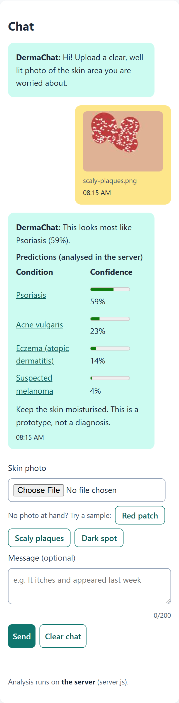

# DermaChat

Thesis prototype: a chatbot where the user uploads a skin photo and gets a skin condition prediction.

Live: https://hamzanaeem627.github.io/culs-frontend-2026/skin-chat/



## Run it

With the server (Node.js, no runtime dependencies):

```sh
cd skin-chat
npm start          # http://localhost:3000
```

Without the server (like GitHub Pages): `npx serve skin-chat`. The photo is then analysed in the browser.
The line under the chat says where the analysis runs.

Tests in a real browser (needs Google Chrome):

```sh
npm install        # Playwright, only for the tests
npm test
```

## How it works

```text
USER ── picks a photo (or a sample) ──► index.html  (structure)
                                          style.css (layout)
                                          app.js    (state, events, DOM)
                                             │
              canvas reads the pixels ───────┤ analyse.js: extractFeatures()
                                             │
          POST api/analyze {redness, …} ─────┼──► server.js ── predict() ──► JSON answer
          no server? predict() right here ◄──┘
                                             │
          fetch data/conditions/<id>.json ───┴──► advice + condition page (#eczema)
```

Only three numbers (redness, darkness, variation) go to the server, never the photo.
The chat (with small thumbnails) is kept in `localStorage`, so it survives a reload.

## Data format

`data/conditions.json` is the list of conditions:

```json
{
  "project": "DermaChat",
  "disclaimer": "…",
  "conditions": [
    { "id": "eczema", "name": "Eczema (atopic dermatitis)", "severity": "low" }
  ]
}
```

Every condition in that list has its own file `data/conditions/<id>.json`:

| Field | Type | Example |
| --- | --- | --- |
| `id` | text, same as the file name | `"eczema"` |
| `name` | text shown to the user | `"Eczema (atopic dermatitis)"` |
| `severity` | `"low"`, `"medium"` or `"high"` | `"low"` |
| `description` | one or two sentences | `"A common condition …"` |
| `symptoms` | list of texts | `["Dry, itchy skin"]` |
| `advice` | list of texts, the first one is used in the chat | `["Moisturise often"]` |

To add a condition: add it to `conditions.json`, add `data/conditions/<id>.json`, and give it a score in `predict()` in `analyse.js`.

## When something is missing

| Situation | What the user sees |
| --- | --- |
| no server (GitHub Pages, server stopped) | "No server found: analysis runs in your browser", the chat still works |
| unknown condition, e.g. `#banana` | "Unknown condition" with a link back to the list |
| condition file missing or broken | "Could not load this condition" with the HTTP error |
| `conditions.json` missing | "Could not load conditions" in the list |
| not an image, or over 10 MB | a message under the form, focus goes back to the file picker |
| `localStorage` full or disabled | the chat works, it is just not remembered |

## Keyboard only

Everything is a real `a`, `button`, `input` or `textarea`, so Tab reaches it and Enter or Space uses it.
Choosing a sample moves focus to *Send*. Opening a condition moves focus to its heading.
Enter in the message box sends; Shift+Enter makes a new line. There is a skip link and a visible focus outline.

## Our own feature: sample photos

You might not want to (or be able to) photograph your skin during a demo.
The *Red patch*, *Scaly plaques* and *Dark spot* buttons fetch a picture from `images/samples/`
and put it into the same file input, so the rest of the chat works exactly as with a real photo.

## Checklists

Day 2, content:

- semantic HTML: `header`, `nav`, `main`, `section`, `figure`, `table`, `details`, `footer`
- clear structure: one `h1`, sections with `h2`/`h3`
- SVG: `logo.svg` plus an inline flow diagram
- JSON data: `data/conditions.json`, plus JSON-LD in the `<head>`
- CSS layout: Flexbox (header, chat) and Grid (hero, steps, cards)
- responsive behaviour: mobile first, `@media (min-width: 48rem)`, `clamp()`
- basic accessibility: skip link, `alt` text, labels, `aria-labelledby`, visible focus
- image and video: sample photos and a screen recording (`demo.webm`)

Day 3, functionality:

- react to input: file picker shows a preview, message counter, Enter sends
- handle events: `submit`, `change`, `input`, `keydown`, `click`, `hashchange`
- maintain state: `state` object in `app.js`, chat saved in `localStorage`
- modify the DOM: `render()` builds the chat, cards and condition pages from data
- fetch data: `data/conditions.json` and `data/conditions/<id>.json`, e.g. `index.html#eczema`
- communicate with a server: `POST api/analyze` and `GET api/health` in `server.js`

Day 4, the project:

- every condition has `data/conditions/<id>.json` in the format above
- published on GitHub Pages
- copes with an unknown condition, a missing file and no server
- works with the keyboard alone
- own feature: sample photos
- tested in a real browser with `npm test`

## Files

| File | What it does |
| --- | --- |
| `index.html` | page structure |
| `style.css` | layout and responsive design |
| `app.js` | chat, state, events, fetch, routing, error messages |
| `analyse.js` | demo photo analysis, shared by browser and server |
| `server.js` | static files, `GET /api/health`, `POST /api/analyze` |
| `data/` | JSON data |
| `images/samples/` | sample photos (drawn, not real patients) |
| `tests/e2e.mjs` | browser test with Playwright |
| `PRESENTATION.md` | the Day 5 talk |

## Known limits

The analysis is a colour heuristic for the demo, not a trained model.
It almost never answers *acne* (0.6% of all feature combinations, and only for very bright photos with little red),
because the eczema or psoriasis score is nearly always higher. A sample photo for acne was planned, but the heuristic could not recognise it.
In the thesis `predict()` will be replaced by a neural network behind the same `api/analyze` endpoint.
